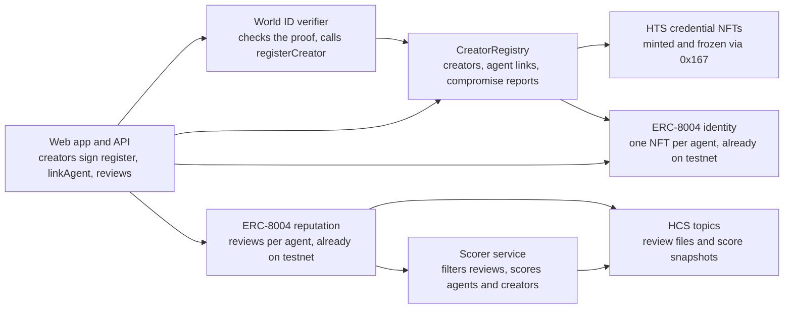

# Human-Backed Agent Reputation on Hedera — Phased Implementation Plan

Nov 6, 2026

## Overview

We are building a human-backed reputation layer for AI agents on Hedera. Every agent's creator is a unique World ID–verified human. Agent reviews live in the ERC-8004 Reputation Registry. Proven misconduct by an agent lowers its creator's score, and a creator cannot escape that by starting over with a new wallet.

The plan has nine phases (0–8). Each ends with manual tests. A phase is done only when every test in it passes on Hedera testnet.

| Component | Status | Built in | Where it lives |
| --- | --- | --- | --- |
| ERC-8004 Identity Registry | Use as-is | — | Testnet `0x8004A818BFB912233c491871b3d84c89A494BD9e` (0.0.7919997) |
| ERC-8004 Reputation Registry | Use as-is | — | Testnet `0x8004B663056A597Dffe9eCcC1965A193B7388713` (0.0.7919998) |
| CreatorRegistry contract | Build | Phase 1 | Hedera EVM |
| Credential NFT collection (HTS) | Build | Phase 1 | HTS, all keys held by CreatorRegistry |
| World ID verifier server | Build | Phase 2 | Backend |
| Reviews topic and scores topic (HCS) | Build | Phases 4–5 | HCS |
| Scorer service | Build | Phase 5 | Backend |
| Web app | Build | Phase 6 | Frontend |
| Agent SDK, REST API and MCP tools | Build | Phase 7 | npm package + backend |

Conventions used in this plan:

- **Network:** Hedera testnet, EVM chain ID 296, JSON-RPC relay `https://testnet.hashio.io/api`, Mirror Node `https://testnet.mirrornode.hedera.com`.
- **Rule of thumb:** reviews go in the registry; credentials go in the wallet.
- **Test IDs:** `T<phase>.<n>`, so failures can be reported by ID.
- **Test accounts:** Creators A, B and C, agents A1, A2, B1 and C1, and an unverified wallet U. All are created in Phase 0.

**Architecture: CreatorRegistry ties each agent to one verified human**

Both ERC-8004 registries are already live on testnet. Everything else in the picture is built in Phases 1–7.

## Phase 0 — Environment and accounts

Goal: every team member can read and write the ERC-8004 registries on Hedera testnet from their own machine.

**Tasks**

1. Create testnet accounts in the Hedera Developer Portal and fund them from the faucet. Use ECDSA (secp256k1) keys so the same accounts work as EVM accounts in HashPack:
   - Operator (deployer, also holds the verifier role on testnet)
   - Creator A, Creator B, Creator C
   - Agent A1, Agent A2, Agent B1, Agent C1
   - Unverified wallet U
2. Set up the repo:
   - `/contracts`: Foundry
   - `/server`: verifier and scorer, Node + TypeScript
   - `/web`: Next.js
   - `/sdk`
3. Add a `hedera_testnet` RPC endpoint to `contracts/foundry.toml`: `https://testnet.hashio.io/api`, chain ID 296. The scripts read keys from the root `.env`.
4. Create `.env.example` with:
   - `OPERATOR_ID`, `OPERATOR_KEY`, `VERIFIER_KEY`
   - `IDENTITY_REGISTRY=0x8004A818BFB912233c491871b3d84c89A494BD9e`
   - `REPUTATION_REGISTRY=0x8004B663056A597Dffe9eCcC1965A193B7388713`
   - `MIRROR_NODE=https://testnet.mirrornode.hedera.com`
   - `WORLD_RP_ID`, `RP_SIGNING_KEY`, `WORLD_ACTION=agent-creator-v1`, `WORLD_ENVIRONMENT`, `WORLD_PROTOCOL_VERSION`
   - `NEXT_PUBLIC_WORLD_APP_ID` for `web/`
5. Copy the ABIs for `IdentityRegistryUpgradeable` and `ReputationRegistryUpgradeable` from the erc-8004-contracts repo into `/contracts/abi`.
6. In the World ID Developer Portal, create a staging app and an action named `agent-creator-v1`, limited to one verification per person. Save the app's `app_id`, its `rp_id` and its RP signing key. The signing key is shown once and is a server secret.
7. Keep two money facts in a shared note:
   - The JSON-RPC relay counts HBAR with 18 decimals; contracts count it with 8.
   - One transaction can use at most 15,000,000 gas.

**Manual tests**

- [ ] T0.1 For each account, `GET /api/v1/accounts/<id>` on the Mirror Node shows a balance above 0 and an `evm_address`.
- [ ] T0.2 `cast block-number --rpc-url https://testnet.hashio.io/api` returns a number.
- [ ] T0.3 Calling `name()` on the Identity Registry returns a string without reverting.
- [ ] T0.4 Calling `getIdentityRegistry()` on the Reputation Registry returns `0x8004A818…BD9e`.
- [ ] T0.5 The `agent-creator-v1` action appears under the staging app in the World ID Developer Portal.

**Exit:** T0.1–T0.5 pass for every team member.

## Phase 1 — CreatorRegistry contract and credential NFTs

Goal: one contract records creators and agent links, and fully controls a non-transferable HTS credential collection.

**Contract functions**

| Function | Who can call | What it does |
| --- | --- | --- |
| `initCredentialToken()` | Admin, once | Creates the HTS NFT collection through the `0x167` system contract. The contract is treasury plus supply, freeze and wipe key. Send about 20 HBAR with the call to cover the roughly $1 creation fee. |
| `registerCreator(bytes32 nullifierHash, address wallet)` | Verifier role | Reverts if the nullifier or wallet is already registered. Stores the creator and emits `CreatorRegistered`. |
| `linkAgent(uint256 agentId)` | A registered creator who is `ownerOf(agentId)` in the Identity Registry | Stores agentId → creator permanently, once. Emits `AgentLinked`. Issues the Human-backed credential to `getAgentWallet(agentId)`, and reverts if the agent has no wallet set. |
| `syncAgentWallet(uint256 agentId)` | That agent's creator, while they still own the NFT | Backs the wallet the agent was moved to after linking, and issues it a Human-backed credential. Reverts if the agent is compromised or the wallet is already linked or synced. Emits `AgentWalletSynced`. |
| `reportCompromise(uint256 agentId)` | That agent's creator | Records the time, once per agent: a second report reverts. The scorer leaves penalties first reported after that time out of the creator's P. Emits `AgentCompromised`. |
| `issueCredential(address to, bytes metadata)` | Issuer role | Mints a serial with metadata of 1 to 100 bytes, unfreezes the holder if it is frozen, transfers the serial, then freezes the holder. |
| `revokeCredential(address holder, int64 serial)` | Issuer role | Unfreezes the holder if it is frozen, wipes the serial, refreezes. Emits `CredentialRevoked`. |
| `creatorOf(agentId)`, `agentsOf(creator)`, `isHumanBacked(address)` | Anyone | Read-only views. `isHumanBacked` is true for creator wallets. It is also true for a wallet that was linked or synced to an agent, if no agent recorded on that wallet has been reported compromised and, for at least one of those agents, `getAgentWallet` still returns the wallet and the creator still owns the NFT. A compromise report never voids a creator wallet. |

**Tasks**

1. Write `CreatorRegistry.sol` with role-based access: admin, verifier, issuer.
2. Check every `0x167` response code, and revert unless it is 22 (SUCCESS).
3. Credential metadata is a short string, because HTS caps NFT metadata at 100 bytes. `linkAgent` and `syncAgentWallet` write `reputed:human-backed:<agentId>`.
4. Deploy to testnet, then call `initCredentialToken()`.
5. Gas estimates for `0x167` calls are unreliable, so every sender sets the limit explicitly. `linkAgent`, `syncAgentWallet` and `issueCredential` use 1,500,000 gas: 1,000,000 is too low for a call that auto-associates the holder. Lower the limits once the Mirror Node shows real gas used. All limits are in the [contracts README](../contracts/README.md#gas-limits).
6. Test locally first: unit tests for every revert path. HTS calls must be tested on testnet or a Hedera local node.

**Manual tests**

- [ ] T1.1 After deploy, the contract appears on HashScan and `identityRegistry()` returns `0x8004A818…BD9e`.
- [ ] T1.2 After `initCredentialToken()`, Mirror Node `GET /api/v1/tokens/<id>` shows type `NON_FUNGIBLE_UNIQUE`, treasury = the contract, and the supply, freeze and wipe keys = the contract.
- [ ] T1.3 `registerCreator` from wallet U (not the verifier) reverts.
- [ ] T1.4 `registerCreator(N0, throwaway wallet)` from the verifier emits `CreatorRegistered`. Repeating with `N0` and a second throwaway wallet reverts. Do not use Creator A or B: `registerCreator` claims a wallet permanently, so T2.1 would then return `WALLET_TAKEN`.
- [ ] T1.5 `issueCredential` to an account with no association and no free auto-association slots fails with `TOKEN_NOT_ASSOCIATED_TO_ACCOUNT` (code 184). Turn the wallet's auto-association off first: funded test wallets have unlimited auto-association, so the call would succeed.
- [ ] T1.6 After that account associates, `issueCredential` succeeds. `GET /api/v1/accounts/<id>/nfts` lists the serial, and HashScan shows the account frozen for the token.
- [ ] T1.7 Transferring that NFT from the holder (HashPack or SDK) fails with `ACCOUNT_FROZEN_FOR_TOKEN`.
- [ ] T1.8 Issuing a second credential to the same holder succeeds (unfreeze, transfer, refreeze).
- [ ] T1.9 `revokeCredential` removes the serial from the holder's NFT list.
- [ ] T1.9b `contracts/script/check-rollback.sh` exits 0: after a failed `revokeCredential`, the holder is still frozen and its balance and `total_supply` are unchanged. If it fails, a failed revoke can leave a credential transferable.

**Exit:** T1.1–T1.9 and T1.9b pass, the contract address and token ID are in `.env`, and the contract source is verified on HashScan.

## Phase 2 — World ID verifier and creator registration

Goal: one verified human becomes exactly one creator record on-chain, bound to the wallet they chose.

**Flow**

1. The app calls `POST /api/rp-signature` with no body. The server signs a request with `RP_SIGNING_KEY` and returns `rp_context` (`rp_id`, `nonce`, `created_at`, `expires_at`, `signature`), plus `action`, `environment` and `protocol_version`. IDKit 4.x will not start without `rp_context`. It expires after 5 minutes.
2. The creator's wallet signs `walletBindingMessage(wallet, action, nonce)` from `@reputed/shared` with EIP-191. A wallet address is public, so the signal alone would let anyone claim someone else's wallet. This signature proves the creator controls it.
3. The web app shows the World ID widget (IDKit) with `app_id`, `rp_context`, action `agent-creator-v1`, and the creator's wallet address as the 0x-prefixed signal. The signal binds the proof to that wallet, so a proof cannot be reused for another wallet.
4. The widget returns the IDKit result: `protocol_version`, `nonce`, `action`, `environment`, and a response with the credential `identifier`, `nullifier` and `signal_hash`.
5. The app sends `POST /api/verify` with `wallet`, `walletSignature` and `idkitResponse`, which is the IDKit result unmodified.
6. The server checks what World's API does not: environment, action, protocol version, exactly one response, an Orb credential, the signal hash against the wallet, the nullifier, and the wallet signature. Any failure returns 400 `INVALID_PROOF`. Only `WORLD_PROTOCOL_VERSION` is accepted, because a human's 3.0 and 4.0 nullifiers differ, so accepting both would let them register twice. An Orb credential is `orb` in protocol 3.0, and `proof_of_human` with issuer schema 1 in protocol 4.0; outside production, issuer schema 128 also passes. Device level is rejected.
7. The server checks the contract: if the nullifier is already registered it returns 409 `ALREADY_REGISTERED`, and if the wallet is already a creator it returns 409 `WALLET_TAKEN`.
8. The server forwards the IDKit result to `POST https://developer.world.org/api/v4/verify/{rp_id}`. A bad proof returns 400 `INVALID_PROOF`. Anything else that is not a clear pass returns 502 `WORLD_UNAVAILABLE`.
9. The server calls `registerCreator(nullifierHash, wallet)` with the verifier key and returns `transactionHash`, `transactionId`, `wallet` and `nullifierHash`. `transactionId` is null if the Mirror Node has not indexed the transaction within about 10 seconds. If an attempt passes World and then fails on-chain, the same wallet can retry without World.
10. The app polls the Mirror Node until `CreatorRegistered` appears. This usually takes a few seconds.

**Tasks**

1. Build `POST /api/rp-signature`. The action comes from server config, not the caller, so it cannot sign for anything else.
2. Build `POST /api/verify`. Validate input, check the proof policy and wallet signature, check the contract, call World's API, submit the transaction, return the transaction hash and ID.
3. Keep the verifier key and the RP signing key only in server environment variables. They never reach the browser.
4. Store no personal data. Log the transaction ID and the nullifier hash only. The server's local record holds only a nullifier hash and a wallet.
5. Rate-limit by IP and by wallet. The wallet limit applies only after the wallet signature passes, so nobody can use up another wallet's limit.
6. Return errors in a fixed shape: `{code, message}` with codes `BAD_REQUEST`, `RATE_LIMITED`, `INVALID_PROOF`, `ALREADY_REGISTERED`, `WALLET_TAKEN`, `WORLD_UNAVAILABLE`, `CHAIN_ERROR`.

**Manual tests** (staging app, World ID Simulator)

- [ ] T2.1 Verify with simulator identity 1 for Creator A. The API returns 200 with a transaction hash, and `CreatorRegistered(N1, CreatorA)` appears on the Mirror Node.
- [ ] T2.2 Verify again with simulator identity 1 for Creator B. The API returns 409 `ALREADY_REGISTERED`, and no new event appears.
- [ ] T2.3 Generate a proof for Creator B, then change the wallet in the request body to wallet U, with wallet U's own signature. The API returns 400 `INVALID_PROOF`. Sending Creator B's proof with a `walletSignature` from another wallet also returns 400 `INVALID_PROOF`.
- [ ] T2.4 Replay T2.1's exact request. The API returns 409, and no event appears.
- [ ] T2.5 Verify simulator identity 2 for Creator A's wallet. The API returns 409 `WALLET_TAKEN`.
- [ ] T2.6 Verify with a device-level credential. The API returns 400 `INVALID_PROOF`, with a message that Orb verification is required.
- [ ] T2.7 Set a wrong `WORLD_RP_ID` on the server and verify. The API returns 502 `WORLD_UNAVAILABLE`, and no transaction is sent.
- [ ] T2.8 Verify simulator identity 2 for Creator B and simulator identity 3 for Creator C. Both succeed, so testing now has three creators.

**Exit:** T2.1–T2.8 pass. Creators A, B and C are all registered.

## Phase 3 — Agent onboarding

Goal: a verified creator registers an agent in ERC-8004 and links it to their creator record, and the agent's wallet receives a Human-backed credential.

**Flow**

1. **Build the agent file.** Follow ERC-8004's registration format:
   - `type`, `name`, `description`, `image`
   - `services`: A2A and MCP endpoints
   - `x402Support`, `active`
   - `supportedTrust: ["reputation"]`
   - `registrations`, filled in at step 4
2. **Host the file.** `POST /api/agent-file` validates the file and returns a base64 `data:application/json` URI and the file's keccak-256 hash. The URI is stored on-chain, so it is capped at 5,000 bytes: use an image URL, not embedded image data. IPFS and HCS-1 hosting are not built, though the indexer can read `ipfs://` and public `https://` URIs.
3. **Register.** The creator wallet calls `register(agentURI)` on the Identity Registry. Read the new `agentId` from the ERC-721 `Transfer` event (minted from `0x0`).
4. **Record the registration.** Add `{agentId, agentRegistry: "eip155:296:0x8004A818BFB912233c491871b3d84c89A494BD9e"}` to `registrations`. Get a new URI from `POST /api/agent-file` and call `setAgentURI`. This step is optional for the MVP.
5. **Set the agent wallet** (only if the agent has its own account). Call `setAgentWallet(agentId, wallet, deadline, signature)` with an EIP-712 signature from the agent's wallet. Otherwise the agent wallet stays the creator's address. If the wallet changes after step 7, the creator must then call `syncAgentWallet(agentId)` with a 1,500,000 gas limit. Until then the new wallet is not human-backed and has no credential. The old wallet stops counting at once, but keeps its frozen NFT until the issuer revokes it.
6. **Associate, only if needed.** A wallet with a free auto-association slot needs nothing here, because the credential transfer associates it. Faucet-funded and hollow accounts have unlimited auto-association. A wallet with no free slots must associate first: either `associate()` on the token's EVM address (works from any EVM wallet, HashPack included) or `TokenAssociateTransaction`. This costs about $0.05.
7. **Link.** The creator calls `linkAgent(agentId)` on CreatorRegistry. The contract checks ownership, stores the link, and issues the Human-backed credential. The sender must set a 1,500,000 gas limit.
8. **Optional for the MVP.** Derive the agent's HCS-14 UAID (Module 9 Lab 5) and publish an HCS-11 profile so HCS-10 tools can find it.

Signatures the creator sees: `register`, then `linkAgent`, plus `associate` from the agent wallet when it is a separate account with no free auto-association slots. Aim for no more than three popups.

**Manual tests**

- [ ] T3.1 `register` from Creator A succeeds. `ownerOf(agentId)` = Creator A, `tokenURI(agentId)` returns the URI, and the JSON opens and parses.
- [ ] T3.2 `linkAgent` from wallet U (not a creator) reverts.
- [ ] T3.3 Creator B calls `linkAgent` on Creator A's agent. It reverts because Creator B is not the owner.
- [ ] T3.4 `linkAgent` for A1 from Creator A emits `AgentLinked`. `creatorOf(A1)` = Creator A, A1's wallet holds a frozen credential serial, and `isHumanBacked(A1 wallet)` is true.
- [ ] T3.5 Calling `linkAgent` for A1 again reverts with `AlreadyLinked`.
- [ ] T3.6 `linkAgent` for an unassociated wallet with free auto-association slots succeeds, and the credential transfer associates it. For a wallet with auto-association turned off, `linkAgent` reverts with `HtsCallFailed` and code 184, and can be retried after associating. The app (Phase 6) prompts association on that error.
- [ ] T3.7 `setAgentWallet` with a wrong signature reverts. With a valid one, `getAgentWallet(agentId)` returns the new wallet. On a linked agent, `isHumanBacked(new wallet)` stays false until the creator calls `syncAgentWallet`. Then it is true and the wallet holds a frozen credential.
- [ ] T3.8 Register and link a spare agent for Creator A, and transfer its identity NFT to Creator B. `creatorOf` is still Creator A, and the agent wallet is cleared, as the spec requires. Do not use A1: Phases 4–5 need its wallet and owner unchanged.
- [ ] T3.9 Register and link A2 for Creator A, B1 for Creator B, and C1 for Creator C. These are needed for Phases 4–5.

**Exit:** T3.1–T3.9 pass. Agents A1, A2, B1 and C1 exist and are linked.

## Phase 4 — Reviews

Goal: a client that paid an agent can review it. The score sits in the Reputation Registry, and the full review, with proof of payment, sits on HCS.

**Review conventions**

| Field | Value |
| --- | --- |
| `value` / `valueDecimals` | 0–100 / 0 |
| `tag1` | `quality` or `misconduct` |
| `tag2` | Category, e.g. `accuracy`, `uptime`, `fraud`, `failed-settlement` |
| `endpoint` | The agent endpoint that was used |
| `feedbackURI` | `hcs://<reviewsTopicId>/<sequenceNumber>` (our own convention) |
| `feedbackHash` | keccak-256 of the review file |

The review file holds the ERC-8004 required fields: `agentRegistry`, `agentId`, `clientAddress`, `createdAt`, `value`, `valueDecimals`. `agentRegistry` and `clientAddress` are CAIP-10 (`eip155:296:0x...`). It also holds the tags, `endpoint`, an optional comment, and an optional `proofOfPayment` (the Hedera transaction ID or EVM hash of the client's payment to the agent wallet). It must stay under 1,024 bytes so it fits in one HCS message.

**Tasks**

1. Create the reviews HCS topic with `server/scripts/create-topics.ts`. The operator key is the submit key, so random accounts cannot spam it; the backend posts files on clients' behalf. The topic has no admin key, so published records cannot be changed.
2. Build `POST /api/review-file`. The body is the review file plus `signature`, an EIP-191 signature by `clientAddress` over the bytes from `serializeReviewFile` in `@reputed/shared`. Unknown fields are rejected, and a missing or wrong signature returns 400 `BAD_REQUEST`. The signature is never published, so `feedbackHash` covers the review alone. The route posts those bytes to HCS and returns `feedbackUri` and `feedbackHash`. The operator pays for every post, so besides the per-IP and per-client rate limits there is a server-wide budget (`REVIEW_MAX_PER_HOUR`, `REVIEW_MAX_CONCURRENT`). Over budget returns 503 `RATE_LIMITED`.
3. The client wallet calls `giveFeedback(agentId, value, 0, tag1, tag2, endpoint, feedbackURI, feedbackHash)`.
4. Support `revokeFeedback(agentId, feedbackIndex)` for the reviewer, and `appendResponse(...)` for the agent's reply.
5. Proof of payment for the MVP: a plain HBAR or token transfer from the client to the agent wallet. Full x402 support via the official `@x402/hedera` packages comes later.
6. The registry already blocks owners and operators from reviewing their own agent. The human-backed filter runs in the scorer (Phase 5), not on-chain.

**Manual tests**

- [ ] T4.1 B1's wallet sends 1 HBAR to A1's wallet. Note the transaction ID.
- [ ] T4.2 B1 reviews A1 (value 90, `quality`) with that payment as proof, signing the file with B1's wallet. `NewFeedback` appears on the Mirror Node, the HCS message is readable, and its keccak-256 equals `feedbackHash`. The same file signed by another wallet returns 400 `BAD_REQUEST`, and nothing is posted.
- [ ] T4.3 Creator A reviews their own agent A1. The registry reverts.
- [ ] T4.4 `readFeedback(A1, B1 wallet, index)` returns value 90 with the tags.
- [ ] T4.5 Wallet U reviews A1 (value 0) with no payment. The review lands on-chain; the scorer must ignore it (checked in T5.2).
- [ ] T4.6 B1 reviews A1 with a made-up payment ID. The review lands on-chain; the scorer must ignore it (checked in T5.3).
- [ ] T4.7 B1 revokes one review. `readAllFeedback` leaves it out by default.
- [ ] T4.8 A1's owner calls `appendResponse` on a review. `ResponseAppended` appears.
- [ ] T4.9 Post a review file to the topic directly from wallet U. It is rejected because of the submit key.

**Exit:** T4.1–T4.9 pass. The reviews topic ID is in `.env`.

## Phase 5 — Scorer service

Goal: every epoch, compute agent and creator scores from public data the same way every time, and publish them to HCS so anyone can recheck them. The numbers below are starting values to tune, not final.

**Inputs**

- Reputation Registry events (`NewFeedback`, `FeedbackRevoked`, `ResponseAppended`), from Mirror Node contract logs
- Review files on the reviews topic
- CreatorRegistry events (`CreatorRegistered`, `AgentLinked`, `AgentWalletSynced`, `AgentCompromised`, `CredentialIssued`, `CredentialRevoked`)
- Identity Registry events (`Registered`, `Transfer`, `MetadataSet`, `URIUpdated`), for each agent's owner and wallet history
- Payment transactions, looked up by ID on the Mirror Node

**Which reviews count.** A review counts only if all of these hold:

- It is not revoked.
- The file hash matches `feedbackHash`, and the file's agent, client, value and tags match the on-chain review.
- The value is between 0 and 100.
- The reviewer was human-backed at the review's consensus time. The scorer replays `isHumanBacked`'s rules from events, because the contract only answers for now.
- The payment succeeded, went from the reviewer to the wallet the agent held at that moment, and happened before the review.
- No earlier eligible review claimed the same payment. A payment counts once.
- The reviewer's wallet was never backed by the agent's creator.

**Agent score.** A weighted average of counted reviews, capped by the agent's own penalties. Each review's weight w is the reviewer creator's score C divided by 100 (never below 0.2), multiplied by a 90-day half-life on the review's age in days, and divided by n, the number of counted reviews that creator left on this agent. A creator therefore has one vote however many reviews it sends. P_agent is the sum of the agent's confirmed penalties after decay, including any left out of the creator's P. It is a cap, not a second subtraction.

$$A = \min\left(\frac{\sum_i w_i v_i}{\sum_i w_i},\; 100 - P_{\text{agent}}\right), \qquad w_i = \frac{\max\left(0.2, \frac{C_{\text{reviewer}}}{100}\right) \cdot 0.5^{\text{age}_i / 90}}{n_i}$$

Reviewer weights need creator scores and creator scores need agent scores, so the scorer starts every creator at 100 − P and iterates, for at most 32 rounds. It reads no earlier snapshot.

An agent with no counted reviews starts at its creator's current score and is shown as "New". An unlinked agent has no creator to inherit from, so it starts at 0. Tiers reuse the HCS-25 lab: Tier 1 at 90 or above, Tier 2 at 75 or above, Tier 3 below.

**Misconduct.** A report is a `misconduct` review that passes every rule above except revocation, with `tag2` set to a category that has a penalty: `fraud` 20 points, `failed-settlement` 10. Other categories never become penalties. The scorer walks the reports for each agent and category in consensus order:

- **Confirmation:** a penalty confirms the moment the open reports within 30 days of each other come from 2 or more different creators. A report revoked before that moment does not help.
- **One incident, one penalty:** for 30 days after a confirmation, further reports on that agent and category add nothing, however many creators send them.
- **Reporter cooldown:** each creator who helped confirm a penalty is ignored on that agent and category for 180 days after it, so a colluding pair cannot grind a target down.
- **Final once confirmed:** revoking a report afterwards does not undo the penalty, even if it was the confirming report. The revoked review still leaves the agent's average.

**Creator score.** The average of the creator's reviewed agents' scores, weighted by each agent's number of distinct reviewer creators, but never above 100 minus P. A creator with no reviewed agents scores 100 minus P. P is the sum of the creator's penalties, each decayed with a 180-day half-life from its confirmation. The cap is what stops dilution: extra good agents raise the average, but cannot lift the score past the penalties.

$$C = \min\left(\overline{A}_{\text{agents}},\; 100 - P\right), \qquad P = \sum_j p_j \cdot 0.5^{\text{age}_j / 180}$$

**Compromise rule.** A penalty whose first report came after an agent's `reportCompromise` still lowers that agent's score, but is left out of the creator's P. The first report sets the date, not the confirmation, so a creator cannot wait for the first report and then report the compromise before the second lands.

**Tasks**

1. Build an indexer that reads events from the Mirror Node with paging, backs off on HTTP 429, and saves the last processed timestamp.
2. Implement the filter and formulas as pure functions with unit tests.
3. Create the scores HCS topic (backend submit key). Publish one snapshot per epoch (hourly by default; `SCORER_EPOCH_SECONDS` changes it): `{epoch, configVersion, epochSeconds, inputsHash, agents:[{agentId, score, tier, counted, excluded}], creators:[{creator, score, P}]}`. Split it across chunks if it is large.
4. Keep indexed data and snapshots in a local SQLite database. The read API serves a live view computed from it, so a new review shows before the next epoch.
5. Publish the config (weights, half-lives, penalties) with a version number, as a `scorer-config` message on the scores topic.

**Manual tests**

- [ ] T5.1 Run on Phase 4 data. A1 = 90, Tier 1. The snapshot appears on the scores topic.
- [ ] T5.2 U's 0-value review from T4.5 is listed as excluded ("not human-backed"). A1 is still 90.
- [ ] T5.3 T4.6's review with the made-up payment is excluded ("payment not found").
- [ ] T5.4 B1 and C1 each report `fraud` against A1, each with its own verified payment. A1 drops, Creator A drops to at most 80 (100 − 20), and Creator B is unchanged.
- [ ] T5.5 A newly linked agent A3 with no reviews shows Creator A's current score and the "New" label.
- [ ] T5.6 Creator A reports A2 compromised, then A2 gets confirmed misconduct. A2 drops, and Creator A's P does not change.
- [ ] T5.7 Creator A's other agents get many 100-value reviews. Creator A stays at or below 100 − P.
- [ ] T5.8 Wipe the cache and rerun from scratch. The snapshot has the same `inputsHash` and identical scores.
- [ ] T5.9 Shift the clock forward 180 days in a test run. Creator A's P halves.

**Exit:** T5.1–T5.9 pass. The scores topic ID and config version are documented.

## Phase 6 — Web app

Goal: a creator can go from wallet connection to a live, public agent page in one sitting, and anyone can check an agent without signing in. Screen details are in the [UI Elements](04-ui-elements.md) doc.

**Milestones**

- **6a (the demo path):** Verify, Onboard agent, public Agent page.
- **6b:** Creator profile, Explorer, Leave a review.

**Stack**

- Next.js with wagmi + viem, using a custom Hedera testnet chain (ID 296, Hashio RPC) for HashPack, the only supported wallet (extension via EIP-6963, mobile via WalletConnect).
- The World ID IDKit React widget (IDKit 4.x, which needs `rp_context` from the server)
- Mirror Node REST for on-chain reads; the backend API for scores and search

**Backend endpoints**

| Endpoint | Purpose |
| --- | --- |
| `POST /api/rp-signature` | Sign the World ID request and return `rp_context` (Phase 2) |
| `POST /api/verify` | World ID → `registerCreator` (Phase 2) |
| `POST /api/agent-file` | Validate an agent file, return its `data:` URI and hash |
| `POST /api/review-file` | Post a signed review file to HCS (Phase 4) |
| `GET /api/agents?q=&humanBacked=&minScore=` | Search linked agents (from the scorer's live view) |
| `GET /api/agents/:agentId` | Agent profile, score, tier, reviews, credentials, creator |
| `GET /api/creators/:address` | Creator score, P, agents |

**Tasks**

1. Wallet connection with a wrong-network check and a one-click network switch.
2. Verify screen wired to the Phase 2 flow: `POST /api/rp-signature`, the wallet signs `walletBindingMessage`, IDKit, `POST /api/verify`, then polling until the creator record appears.
3. Onboard wizard covering Phase 3 steps 1–7. It saves progress so a closed tab can resume. It sets a 1,500,000 gas limit on `linkAgent` and `syncAgentWallet`.
4. Public agent page built from the API and Mirror Node, with HashScan links on every on-chain item.
5. 6b screens. The review modal has the wallet sign the bytes from `serializeReviewFile` before `POST /api/review-file`.
6. Every transaction button shows waiting-for-signature, submitted, confirmed and failed states.

**Manual tests** (fresh browser profile each time)

- [ ] T6.1 Connect HashPack on the wrong network (it starts on mainnet, 295). A "Switch to Hedera Testnet" banner appears, and its button switches networks.
- [ ] T6.2 Verify end to end as a new creator. The "Verified creator" badge appears within about 10 seconds, without a page refresh.
- [ ] T6.3 Visit /onboard as wallet U. The page sends the user to Verify first.
- [ ] T6.4 Onboard an agent end to end. The success screen shows the agent ID, HashScan links and the credential.
- [ ] T6.5 Close the tab after `register` but before `linkAgent`, then reopen. The app resumes at the Link step.
- [ ] T6.6 Reject a signature in the wallet. The app shows "Cancelled" with a retry button, and nothing breaks.
- [ ] T6.7 The agent page shows score, tier, Human-backed badge, creator score, reviews with payment-verified marks, and credentials.
- [ ] T6.8 The agent page loads with no wallet connected.
- [ ] T6.9 In the explorer, "Human-backed only" hides agents that are not human-backed.
- [ ] T6.10 On their own agent's page, the creator sees the review button disabled, with the reason.
- [ ] T6.11 At a 390 px wide screen, Verify, Onboard and the Agent page are all usable.

**Exit:** 6a tests (T6.1–T6.8, T6.11) pass for the demo. T6.9–T6.10 pass after 6b.

## Phase 7 — Agent SDK, API and MCP tools

Goal: agents can check and review each other in code, with the same rules as the web app.

**SDK functions** (TypeScript package, also exposed as REST)

| Function | Returns |
| --- | --- |
| `getAgent(agentId)` | Profile, score, tier, creator, creator score, credentials |
| `isHumanBacked(address)` | `true` / `false` |
| `verifyCounterparty(agentId, {minScore, humanBackedOnly})` | `{ok, reason}` — a gate to run before paying or hiring an agent |
| `review({agentId, value, tag1, tag2, paymentTxId, comment})` | The review transaction ID. Signs and hosts the file, then calls `giveFeedback`. |

**Tasks**

1. Package the read functions on top of the backend API, and the write functions on top of viem with the caller's key.
2. Publish typed errors: `NOT_HUMAN_BACKED`, `SCORE_TOO_LOW`, `PAYMENT_NOT_FOUND`, `SELF_REVIEW`, `CHAIN_ERROR`.
3. Add a small MCP server exposing `get_agent`, `verify_counterparty` and `review_agent`, so LLM-based agents can use the layer directly.
4. Write a 20-line example script: agent B1 checks A1, pays it, then reviews it.

**Manual tests**

- [ ] T7.1 B1 runs `verifyCounterparty(A1, {minScore: 75})` before misconduct and gets `ok: true`. After T5.4 it gets `ok: false` with `SCORE_TOO_LOW`.
- [ ] T7.2 The example script runs end to end. The review shows on A1's page within one scorer epoch.
- [ ] T7.3 `review()` from Creator A's key on A1 returns `SELF_REVIEW`, and no transaction is sent.
- [ ] T7.4 `review()` from an account with no HBAR returns `CHAIN_ERROR`. A hosted file with no matching review is ignored by the scorer.
- [ ] T7.5 Through the MCP server, an assistant asked "Is agent \<A1 id> safe to hire?" calls `verify_counterparty` and reports the score and human-backed status.

**Exit:** T7.1–T7.5 pass. The package README shows the example script.

## Phase 8 — Demo script, hardening and mainnet readiness

Goal: a 5-minute demo that runs the same way every time, and a short list of what must change before mainnet.

**Demo script** (fresh accounts, staging World ID)

1. Creator A verifies with World ID. The "Verified creator" badge appears.
2. Creator A onboards "TradeBot A1". Show the agent page and the frozen credential on HashScan.
3. Creator B's agent B1 runs `verifyCounterparty`, pays A1 1 HBAR, and leaves a 90 review. A1 shows 90, Tier 1.
4. A1 fails a settlement. Two human-backed reviewers from different creators report misconduct. Next epoch: A1 drops, and Creator A drops.
5. Creator A tries to start over: same human, new wallet. World ID blocks a second creator record.
6. Creator A onboards A2. A2 starts at Creator A's lowered score. This is the payoff: reputation follows the human.

To keep the demo short, set the scorer epoch to 1 minute and pre-fund every account.

**Hardening**

- [ ] Separate keys for the admin, verifier and issuer roles. The verifier key lives in a secrets manager.
- [ ] Contract unit tests for every revert path. HTS paths are tested on a Hedera local node or testnet.
- [ ] API rate limits; Mirror Node backoff on HTTP 429.
- [ ] Scorer config is versioned and published. The snapshot includes `configVersion` and `inputsHash`.
- [ ] Error monitoring on the verifier and scorer, plus an alert if no snapshot is published for 2 epochs.
- [ ] Decide the upgrade policy for CreatorRegistry: immutable, or upgradeable behind a timelock.

**Before mainnet**

- [ ] ERC-8004 lists only a Hedera testnet deployment. Either deploy the Identity and Reputation registries on mainnet yourself, or wait for an official deployment.
- [ ] Switch the World ID app to production. Orb-level verification is already required.
- [ ] Replace the single verifier with 2-of-3 verifiers, and publish proofs so anyone can re-verify.
- [ ] Re-price fees at the live exchange rate.

**Manual tests**

- [ ] T8.1 Run the full demo script twice in a row on fresh accounts. Each run is under 5 minutes with no manual fixes.
- [ ] T8.2 Run the demo on a phone-width browser. Every step works.
- [ ] T8.3 Stop the scorer mid-demo, then restart it. It catches up, and its scores match a clean run.

**Exit:** T8.1–T8.3 pass. The demo video is recorded.

## Risks and open questions

The biggest risk is trust in our own verifier: until it is split across several parties, one server decides who counts as a human.

| Risk | Impact | Mitigation |
| --- | --- | --- |
| Single World ID verifier | It could register fake creators | 2-of-3 verifiers; publish proofs for re-verification |
| Fake negative reviews (griefing) | Honest creators lose score | Count only human-backed, paid reviews; weight by reviewer score; misconduct needs 2 creators; one penalty per incident; reporter cooldown |
| ERC-8004 is a draft standard, and its registries are upgradeable by their admin | The ABI or its behaviour could change | Pin ABIs; watch the spec repo; re-run Phases 3–4 tests after upgrades |
| No Hedera mainnet ERC-8004 deployment | Blocks the mainnet launch | Deploy our own copy, or wait |
| World ID adoption and biometric concerns | Fewer creators | Optional lower tier for unverified creators (open question) |
| Mirror Node lag of a few seconds | The UI looks stuck | Poll with progress states; show "confirming" |
| `0x167` gas estimates are unreliable | Failed transactions | Generous gas limits, tuned from real gas used |
| Agent lists are public per creator | A creator's agents can be linked to each other (not to the person) | State it at onboarding |

**Decisions to make**

- [ ] Who confirms misconduct: keep the built 2-creator rule, or move to an arbiter role or our own deployment of the ERC-8004 Validation Registry?
- [ ] Penalty sizes (built: fraud 20, failed settlement 10) and half-lives (reviews 90 days, penalties 180 days).
- [ ] Keep Orb-only, as built, or also allow device-level World ID at a lower tier?
- [ ] Keep agent files as `data:` URIs, as built, or host agent and credential files on IPFS (needs a pinning service) or HCS-1?
- [ ] Scorer epoch length after the demo: hourly or daily?
- [ ] Should creators be able to move their creator record to a new wallet with a fresh World ID proof?

## Sources

- [ERC-8004 specification (EIP-8004)](https://eips.ethereum.org/EIPS/eip-8004)
- [ERC-8004 contracts and deployments](https://github.com/erc-8004/erc-8004-contracts)
- [HCS-25 AI Trust Score Methodology](https://hol.org/docs/standards/hcs-25/)
- [HCS-14 Universal Agent ID](https://hol.org/docs/standards/hcs-14/)
- [World AgentKit docs](https://docs.world.org/agents/agent-kit)
- [World ID request signatures](https://docs.world.org/world-id/idkit/signatures) and [verify API](https://docs.world.org/api-reference/developer-portal/verify)
- [HTS system contract docs](https://docs.hedera.com/evm/hedera-services/system-contracts/hts)
- Hedera by Example labs: Module 8 Lab 8 (HTS from Solidity), Module 9 Labs 4–5 (HCS-11, HCS-14), Module 14 Lab 2 (HCS-25)
- Testnet registry contracts 0.0.7919997 and 0.0.7919998, checked on the Hedera Mirror Node on 2026-11-06
